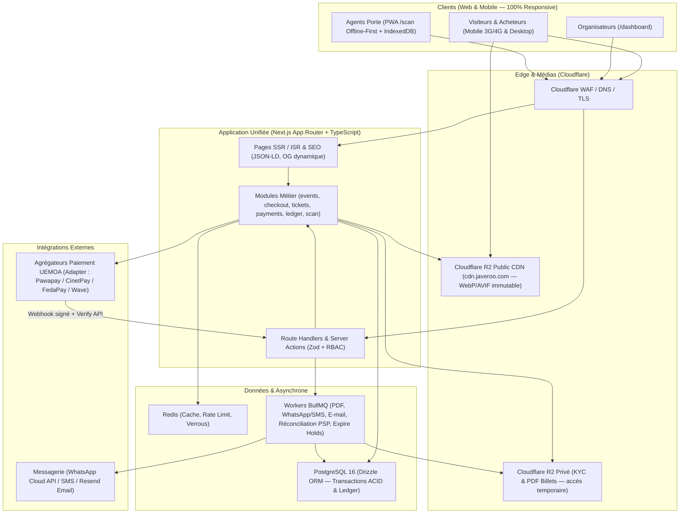
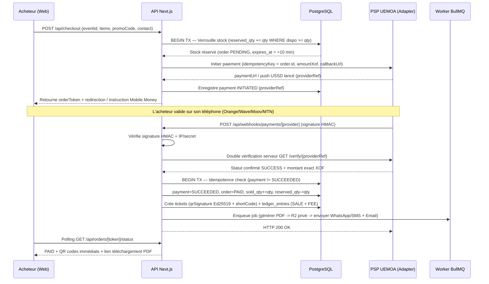
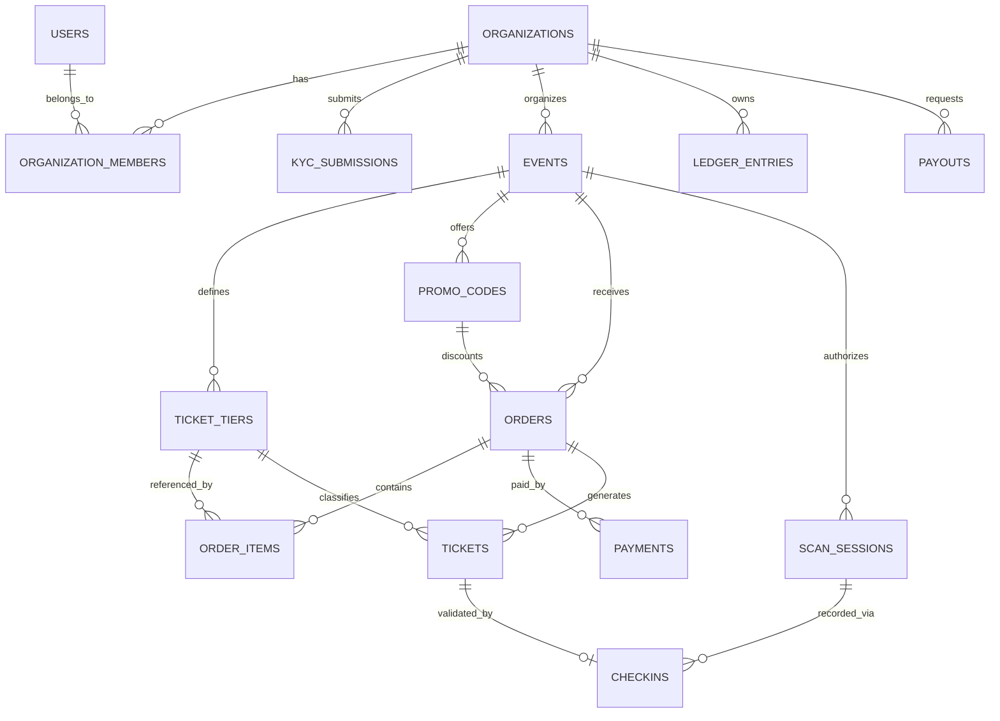

# Cahier des Charges & Architecture Technique — **Javeroo-Billeterie** (MVP V1)

- **Projet** : **Javeroo-Billeterie** — Plateforme de billetterie événementielle Web-First & Mobile Money
- **Périmètre V1 (MVP)** : Billetterie & événements (QR code cryptographique, PWA de scan hors-ligne, guest checkout web)
- **Marché de lancement** : **Afrique de l'Ouest — Zone UEMOA (8 pays, devise unique `XOF / FCFA`)**
- **Stack cible** : **Next.js (App Router, TypeScript strict, Tailwind CSS v4) · PostgreSQL (Drizzle ORM) · Redis/BullMQ · Cloudflare R2**
- **Référence concurrentielle** : Conçu pour surclasser structurellement les faiblesses identifiées lors de l'audit complet de `tigsi.net` / `app.tigsi.net`

---

## 1. Vision Produit & Positionnement Stratégique

### 1.1 Proposition de valeur
> **« La billetterie UEMOA la plus rapide, la plus transparente et la plus fiable : achetez en 30 secondes par Mobile Money sans installer d'application, scannez à l'entrée même sans réseau, encaissez sans mauvaise surprise. »**

Plutôt que de se disperser dès le lancement sur 7 modules inachevés (catalogue sans filtres, dons vides, pubs intrusives), **Javeroo-Billeterie V1** adopte une stratégie **laser sur le cœur de métier Billetterie**, avec une architecture modulaire prête à activer les relais de croissance en V2 (Badges viraux *« J'y serai »*, Votes sans pub, Diaspora EUR/USD).

### 1.2 Matrice « Anti-Tigsi » : transformer chaque faiblesse concurrente en avantage structurel

| Faiblesse constatée sur Tigsi | Décision produit / technique Javeroo-Billeterie |
| :--- | :--- |
| **Migration éclatée** (Laravel/Inertia + Next.js, 2 palettes, 2 polices, routes `/events/...` legacy) | **Mono-stack unifiée Next.js App Router + Design System unique** couvrant site public, checkout, espace organisateur et PWA scan. |
| **7 contradictions inter-pages** (délais `24h` vs `72h` vs `5j`, tarifs `5k` vs `25k`, `14` vs `17` pays, `85k+` vs `10k+`) | **Source de vérité unique en code** (`config/pricing.ts`, `config/uemoa.ts`) consommée partout : homepage, `/tarifs`, dashboard, checkout et CGV. |
| **Catalogue `/fr/evenements` sans filtres, sans prix et promoteurs cassés** (`Promoteur` ×5) | **Moteur de recherche & filtres URL complets** (pays, ville, date, catégorie, gratuit/payant), prix affiché dès la carte, vraies pages promoteurs `/promoteurs/[slug]`. |
| **Bandeaux poussant vers l'app (lien Android-only) & coupons bloqués sur le web** | **100 % Web-First (iOS + Android égaux)** : guest checkout complet, **codes promo disponibles sur le web**, billets livrés instantanément sur page + PDF + WhatsApp/SMS + E-mail. |
| **Cache-busting massif par URLs présignées S3/R2 + images `.jpg` brutes + fuite `dev/` en prod** | **CDN public Cloudflare R2 dédié** (`cdn.javeroo.com`) avec conversion **WebP/AVIF + `srcset` + `Cache-Control: immutable`**, et séparation physique stricte `dev`/`staging`/`prod`. |
| **Pubs interstitielles bloquantes en tunnel payant** | **Politique Zéro Publicité** dans tous les parcours d'achat et de billetterie. |
| **Données de test développeur en production** (`Miss Test 2024`, `CRUD Don`) | Environnements isolés + modération publication + garde-fous automatisés empêchant les seeds de test en prod. |
| **Accessibilité et conformité légale fragiles** (`<main>` imbriqué, modales sans `role="dialog"`, `privacy@tigsi.com`, pas de *Mentions légales* ni CMP) | Composants **Radix UI / shadcn** conformes WCAG 2.1 AA, *Mentions légales* + CGU/CGV + Confidentialité complets dès J1, CMP légère si trackers activés. |

### 1.3 Périmètre géographique & Positionnement tarifaire UEMOA

- **Zone V1 homogène (8 pays UEMOA — devise unique `XOF`)** :
  🇧🇫 Burkina Faso · 🇨🇮 Côte d'Ivoire · 🇸🇳 Sénégal · 🇧🇯 Bénin · 🇹🇬 Togo · 🇲🇱 Mali · 🇳🇪 Niger · 🇬🇼 Guinée-Bissau.
  *(Avantage technique majeur : zéro gestion de taux de change en V1, montants stockés en entiers `XOF`, et zéro erreur type `Guinée · XOF`.)*
- **Grille tarifaire compétitive recommandée (face aux `12 %` de Tigsi)** :
  - **Abonnement organisateur** : **`0 FCFA / mois`** (création de compte et publication d'événements gratuits à **`0 %`**).
  - **Billets payants** : **`8 %` tout inclus** (couvrant les frais PSP Mobile Money ~1,5 %–3 % + coûts SMS/WhatsApp + infrastructure, pour une marge nette saine de ~4,5 %–6 %).
  - **Flexibilité transparente** : l'organisateur choisit par événement si la commission est **absorbée dans le prix du billet** (ex. billet 5 000 FCFA → acheteur paie 5 000 FCFA, organisateur reçoit 4 600 FCFA) ou **ajoutée à l'acheteur** (affichée clairement *avant* le paiement, jamais cachée).
  - **Grands comptes / volume** : palier négocié dès 3 000+ billets (ex. `6 %` sur contrat).
- **SLA de reversement unique (affiché à l'identique partout)** :
  - Reversement Mobile Money sous **48 h ouvrées** après demande sur le solde disponible (compte KYC validé), et virement bancaire sous **3 à 5 jours ouvrés** (frais bancaires réels indiqués avant confirmation).
  - Règle anti-fraude claire : pour un nouvel organisateur non encore vérifié par un premier événement réussi, possibilité de débloquer un acompte partiel ou de libérer le solde à **J+1 après le début de l'événement** (règle transparente et écrite dans les CGVPS).

---

## 2. Cahier des Charges Fonctionnel (MVP V1)

### 2.1 Rôles et permissions (RBAC)

| Rôle | Scope d'accès | Capacités principales |
| :--- | :--- | :--- |
| **`Guest` (Visiteur / Acheteur invité)** | Public | Parcourir, filtrer, appliquer un code promo, acheter des billets sans compte, télécharger le PDF, retrouver ses billets via OTP téléphone/e-mail. |
| **`User` (Acheteur connecté — optionnel)** | Compte personnel | Historique centralisé « Mes billets », reçus, transfert de billet (V1.1), favoris. |
| **`Organizer` (`Owner` / `Manager`)** | `/dashboard` (scopé par `organization_id`) | Créer/éditer événements, catégories de billets, codes promo, invitations gratuites, suivre les ventes en direct, gérer les agents de scan, soumettre le KYC, demander des reversements. |
| **`Scanner` (Agent de contrôle porte)** | `/scan` (PWA scopée par `event_id`) | Connexion par code PIN/QR événement temporaire, scanner les billets (online & offline), rechercher un participant par nom/code court, **zéro accès aux finances**. |
| **`PlatformAdmin` (`Admin` / `Finance` / `Support`)** | `/admin` | Modérer les événements, valider les dossiers KYC, traiter/tracer les reversements, gérer les remboursements et litiges, consulter les journaux d'audit. |

### 2.2 Module A — Vitrine, Catalogue & Pages Événements (`/`, `/evenements`, `/promoteurs`)
- **Header unifié** : Logo, `Événements`, `Tarifs`, `Organisateurs`, recherche rapide, CTA secondaire `Connexion`, CTA primaire `Créer un événement` (accès B2B visible dès le header !).
- **Catalogue `/evenements`** :
  - **Filtres synchronisés en query params** (partageables et indexables) : `pays`, `ville`, `categorie` (Concert, Festival, Conférence, Sport, Humour, Culture, Formation, Soirée), `periode` (Aujourd'hui, Ce week-end, Ce mois, Dates personnalisées), `prix` (Tous, Gratuit, Payant, Plafond XOF), `q` (recherche texte plein champ PostgreSQL `tsvector` + `pg_trgm`).
  - **Tri** : Prochains événements (défaut), Populaires, Prix croissant.
  - **Pagination propre** (ex. 24 cartes/page, URL `?page=2`, zéro doublon entre sections).
  - **Cartes événements informatives** : affiche recadrée proprement (ratio contrôlé sans couper les titres), date + heure, ville + drapeau pays, **prix affiché (`Gratuit` ou `Dès 3 000 FCFA`)**, badge de rareté (`Dernières places`, `Complet`), nom cliquable du promoteur.
- **Page Promoteur `/promoteurs/[slug]`** : logo, bio vérifiée (badge *Organisateur vérifié* après KYC), liens sociaux, événements à venir et passés.
- **Fiche Événement `/evenements/[slug]`** :
  - Visuel complet consultable en lightbox (pour lire tout le texte des flyers événementiels !), description structurée, date/heure avec fuseau local, lieu structuré (nom du lieu, quartier, ville, pays, carte légère + lien itinéraire Google Maps — **jamais de coordonnées GPS brutes**).
  - Liste des catégories de billets (nom, description, prix XOF, statut `Disponible` / `Bientôt` / `Épuisé`, stock restant optionnel).
  - Partage en 1 clic (WhatsApp pré-formaté, Copier le lien, Facebook, X) avec **aperçu Open Graph dynamique** (affiche + date + prix + ville).

### 2.3 Module B — Tunnel d'Achat & Livraison Billets (Guest Checkout)
1. **Étape 1 — Sélection (`Formule & Code promo`)** :
   - Sélection multi-catégories possible dans une même commande (ex. 2× Normal + 1× VIP, max configurable par commande).
   - Champ **Code promo** directement utilisable sur le web (remise `%` ou montant fixe `XOF`, validation temps réel de quota/expiration).
   - Récapitulatif clair : sous-total, remise, frais de service éventuels (`0 FCFA` si absorbés), **Total à payer en FCFA**.
2. **Étape 2 — Coordonnées & Verrouillage de stock** :
   - Formulaire minimal accessible (`<label>` explicites, `id`/`name` valides) : Nom complet, Numéro WhatsApp / Téléphone (indicatif UEMOA par défaut selon pays de l'événement), E-mail (recommandé pour PDF).
   - Option (configurable par événement) : nom nominatif différent par billet si quantité > 1.
   - À la validation : création d'une commande `PENDING` + **réservation atomique du stock pendant 10 minutes** (`expires_at`), avec compte à rebours visible.
3. **Étape 3 — Paiement Mobile Money & Carte** :
   - Choix de l'opérateur selon le pays (Orange Money, Wave, Moov Money, MTN MoMo, Mixx by Yas / T-Money, Visa/Mastercard).
   - Redirection sécurisée ou saisie numéro + déclenchement push USSD/OTP selon l'agrégateur.
   - Écran d'attente en temps réel (SSE ou polling intelligent sur `GET /api/orders/[id]/status`) avec reprise propre si l'utilisateur ferme l'onglet.
4. **Post-Paiement — Émission & Livraison Multi-Canal** :
   - Dès confirmation webhook vérifiée serveur-à-serveur : passage en `PAID`, génération des billets individuels (`QR code signé` + `code court 8 car.` + `PDF A4/mobile`).
   - Affichage immédiat sur la page de confirmation (`/commandes/[token]`) avec bouton **Télécharger les billets (PDF)** et **Recevoir sur WhatsApp**.
   - Envoi asynchrone garanti (BullMQ avec retries) par **E-mail (PDF joint)** + **WhatsApp Business / SMS** (lien sécurisé + code court).
   - **Portail « Retrouver mes billets » (`/mes-billets`)** : saisie téléphone ou e-mail → OTP 6 chiffres → accès immédiat à tous les billets achetés en mode invité.

### 2.4 Module C — Contrôle d'Accès à l'Entrée (PWA Scan QR Offline-First)
- **Accès terrain sans friction** : l'organisateur crée des **sessions de scan** par événement (ex. « Porte VIP », « Entrée Principale ») protégées par un **code d'accès temporaire à 8 caractères ou QR d'appairage** révocable à tout moment.
- **Vérification cryptographique hors-ligne** :
  - Chaque billet encode un payload compact signé (`Ed25519` ou `HMAC-SHA256`) : `v1.<ticketId>.<eventId>.<tierCode>.<signature>`.
  - À l'ouverture de la session `/scan`, la PWA télécharge en **IndexedDB** la clé publique de vérification + la liste légère (hashes + noms + statuts) des billets valides de l'événement (ex. 5 000 billets ≈ ~450 KB compressés).
  - **En mode connecté** : validation immédiate via `POST /api/scan/checkin` (atomicité serveur multi-portes).
  - **En mode hors-ligne (coupure 4G au stade/concert)** : vérification locale cryptographique + contrôle de doublon local IndexedDB → file d'attente synchronisée automatiquement dès le retour du réseau, avec alerte visuelle en cas de conflit multi-portes détecté à la resynchronisation.
- **Ergonomie terrain (environnement sombre & bruyant)** : écran plein cadre vert/rouge/orange à fort contraste + bip sonore distinct + vibration, affichage grand format du type de billet (`VIP` / `Normal`) et du nom, compteur live (`412 / 600 entrés`), recherche manuelle de secours par code court ou téléphone.

### 2.5 Module D — Espace Organisateur (`/dashboard`)
- **Inscription & Onboarding** : Email ou Téléphone + OTP → création d'organisation immédiate → création d'événement en brouillon sans blocage.
- **Gestion Événement** :
  - Formulaire guidé en 4 étapes : *Infos & Lieu* → *Visuel (recadrage guidé + aperçu carte)* → *Billets & Quotas* → *Paramètres (frais, codes promo, publication)*.
  - Génération d'invitations gratuites nominatives (presse, partenaires, VIP) avec QR code identique au flux payant.
- **Tableau de bord & Analytique** :
  - Ventes nettes, billets vendus par catégorie, taux de remplissage, taux de présence scannée en direct, export CSV/Excel des participants.
- **KYC & Portefeuille financier** :
  - Dépôt KYC sécurisé (pièce d'identité, selfie/justificatif, RCCM/IFU si société, numéro Mobile Money ou RIB vérifié par OTP).
  - Vue transparente du **Grand Livre** : `Solde brut` − `Commissions` = `Solde net` (distinction `En attente` vs `Disponible au retrait`).
  - Demande de retrait en 1 clic vers le compte vérifié + historique des virements et reçus PDF.

### 2.6 Module E — Back-Office Plateforme (`/admin`)
- File de modération des événements nouvellement publiés (détection doublons/arnaques, mise en avant *« À la une »*).
- File de validation KYC (`En attente` → `Approuvé` / `Rejeté avec motif` → notification automatique).
- Gestion des demandes de reversement (validation finance, référence de virement PSP/banque, clôture comptable).
- Gestion des remboursements (annulation d'événement ou remboursement unitaire), désactivation de billet frauduleux, journaux d'audit immuables.

---

## 3. Architecture Technique

### 3.1 Vue d'ensemble (Monolithe Modulaire Next.js)



### 3.2 Choix de stack détaillés

| Couche | Technologie recommandée | Pourquoi ce choix (et quel piège Tigsi il évite) |
| :--- | :--- | :--- |
| **Framework Full-Stack** | **Next.js 15+ (App Router, TypeScript strict)** | Un seul codebase pour SSR/SEO, checkout, dashboard et PWA scan. Élimine la double stack Laravel + Next.js. |
| **UI & Accessibilité** | **Tailwind CSS v4 + shadcn/ui (Radix UI)** | Compilation propre sans `!important`, primitives accessibles natives (`Dialog`, `Select`, `Tabs`, focus trap, `aria-*`). |
| **Validation** | **Zod** + **React Hook Form** | Schémas partagés client/serveur garantissant des formulaires typés, labellisés et protégés contre les données sales. |
| **Base de données** | **PostgreSQL 16 + Drizzle ORM** | ACID strict pour éviter la survente, recherche full-text `tsvector` + trigrammes `pg_trgm` sans Elasticsearch en V1, requêtes SQL transparentes. |
| **Cache & Queues** | **Redis + BullMQ** | Libération garantie des réservations expirées (10 min), retries WhatsApp/SMS/PDF, réconciliation PSP résiliente. |
| **Stockage & Images** | **Cloudflare R2** (2 buckets : `public` + `private`) + **Sharp / CF Images** | Zéro frais d'egress, URLs publiques permanentes cachables 1 an en WebP/AVIF (fin du cache-busting SigV4 !), isolation stricte des pièces KYC. |
| **Auth** | **Auth.js v5** ou **Better Auth** (sessions DB/Redis + OTP Email/SMS) | Contrôle total des rôles RBAC (`organization_members`), pas de lock-in, comptes unifiés acheteur/organisateur. |
| **PDF & QR** | **`qrcode`** + **`@react-pdf/renderer`** (ou Typst/Playwright léger) + **`crypto` (Ed25519)** | Génération rapide en worker, billets lisibles hors-ligne, signature infalsifiable. |
| **Observabilité** | **Sentry** (erreurs front/back) + **Pino** (logs JSON structurés) + **Uptime monitor** | Détection immédiate des `ERR_FAILED`, échecs webhooks ou lenteurs SQL. |

### 3.3 Séquence critique : Achat billet, Hold atomique & Webhook idempotent



> **Sécurité anti-perte de webhook** : un job BullMQ de **réconciliation** interroge toutes les 3 minutes les commandes `PENDING` âgées de 2 à 15 minutes auprès de l'API du PSP. Si le paiement a réussi côté PSP mais que le webhook a échoué, les billets sont tout de même émis automatiquement ; si le paiement a expiré au-delà de 10 minutes, la commande passe en `EXPIRED` et `reserved_qty` est restitué atomiquement au stock.

---

## 4. Modèle de Données PostgreSQL (Schéma ER & Invariants)

### 4.1 Diagramme Entité-Relation (MVP V1)



### 4.2 Détail des tables critiques & garde-fous d'intégrité

1. **Montants financiers** : **100 % en entiers `INTEGER` / `BIGINT` (`amount_xof`)** — jamais de `FLOAT` ni de `DOUBLE`. Devise fixée à `'XOF'` en V1 avec colonne `currency CHAR(3) DEFAULT 'XOF'` pour préparer la V2 multi-devises sans migration destructive.
2. **`events`** :
   - `id (uuid)`, `organization_id`, `slug (unique)`, `title`, `description`, `category`, `status (DRAFT|PENDING_REVIEW|PUBLISHED|CANCELLED|ENDED)`, `country_code (CHAR 2 — contrainte CHECK sur les 8 pays UEMOA)`, `city`, `venue_name`, `venue_address`, `latitude`, `longitude`, `starts_at (timestamptz)`, `ends_at (timestamptz)`, `timezone`, `cover_image_key` (clé R2 publique), `fee_bearer (ORGANIZER|BUYER)`, `commission_bps (int, défaut 800 = 8,00 %)`, `published_at`.
   - Index : `GIN` sur `to_tsvector('french', title || ' ' || city || ' ' || venue_name)`, index composite `(status, country_code, starts_at)` pour des requêtes catalogue < 15 ms.
3. **`ticket_tiers`** :
   - `id`, `event_id`, `name`, `description`, `price_xof (int >= 0)`, `total_qty (int)`, `sold_qty (int DEFAULT 0)`, `reserved_qty (int DEFAULT 0)`, `max_per_order (int DEFAULT 10)`, `sale_starts_at`, `sale_ends_at`, `sort_order`.
   - **Contrainte SQL de sécurité** : `CHECK (sold_qty >= 0 AND reserved_qty >= 0 AND sold_qty + reserved_qty <= total_qty)` — rend la survente mathématiquement impossible au niveau moteur de base de données !
4. **`orders` & `payments`** :
   - `orders` : `id`, `public_token (nanoid sécurisé)`, `event_id`, `user_id (nullable pour guest)`, `buyer_name`, `buyer_phone`, `buyer_email`, `promo_code_id`, `subtotal_xof`, `discount_xof`, `buyer_fee_xof`, `platform_commission_xof`, `total_xof`, `status (PENDING|PAID|EXPIRED|CANCELLED|REFUNDED)`, `expires_at`.
   - `payments` : `id`, `order_id`, `provider (PAWAPAY|CINETPAY|FEDAPAY|WAVE|...)`, `provider_ref (unique)`, `idempotency_key (unique)`, `method (ORANGE_MONEY|WAVE|MOOV|MTN|CARD)`, `amount_xof`, `status (INITIATED|SUCCEEDED|FAILED|REFUNDED)`, `raw_webhook_payload (jsonb)`, `verified_at`.
5. **`tickets` & `checkins`** :
   - `tickets` : `id`, `order_id`, `event_id`, `ticket_tier_id`, `attendee_name`, `short_code (unique, ex. JVR-8K4P-2M9Q)`, `qr_token` (payload signé Ed25519), `pdf_r2_key`, `status (VALID|USED|REVOKED|REFUNDED)`.
   - `checkins` : `id`, `ticket_id (UNIQUE — garantie 1 seul check-in valide)`, `event_id`, `scan_session_id`, `scanned_at`, `synced_at`, `was_offline (boolean)`, `device_id`.
6. **`ledger_entries` (Grand Livre Comptable Append-Only)** :
   - `id`, `organization_id`, `order_id (nullable)`, `payout_id (nullable)`, `entry_type (TICKET_SALE|PLATFORM_COMMISSION|PAYMENT_FEE|REFUND|PAYOUT_HOLD|PAYOUT_RELEASE|ADJUSTMENT)`, `amount_xof (signed bigint : positif crédit, négatif débit)`, `currency`, `available_at (timestamptz)`, `created_at`.
   - **Règle d'or** : aucune requête `UPDATE` ou `DELETE` autorisée sur `ledger_entries`. Le solde disponible d'un organisateur est toujours `SUM(amount_xof) WHERE available_at <= NOW()`.

---

## 5. Sécurité, Performance 3G/4G, SEO, Accessibilité & Conformité

### 5.1 Sécurité & Hygiène d'environnement
- **3 environnements physiquement isolés** : `dev` (local), `staging` (preview + PSP sandbox), `prod` (données réelles uniquement). **3 bases PostgreSQL et 3 paires de buckets R2 distincts** — rendant impossible toute fuite de chemins `dev/` ou d'événements `Test` en production.
- **Protection KYC & Données Personnelles** : pièces d'identité stockées dans le bucket R2 privé chiffré, accessibles uniquement via URL signée courte (60 s) réservée au rôle `PlatformAdmin`, avec journalisation dans `audit_logs`.
- **Anti-abus** : rate-limiting Redis sur OTP SMS/WhatsApp (max 3/10 min par numéro), création de commande (anti-scalping bloquant le stock), et tentatives de codes promo.
- **Sécurité HTTP** : `Content-Security-Policy` stricte, `Strict-Transport-Security`, `X-Content-Type-Options: nosniff`, cookies de session `HttpOnly; Secure; SameSite=Lax`, protection CSRF native sur mutations.

### 5.2 Budget Performance (Optimisé Mobile 3G/4G Afrique de l'Ouest)
- **Objectifs mesurables** : `LCP < 2,0 s`, `CLS = 0`, `INP < 200 ms`, transfert initial `< 600 KB` sur `/evenements`.
- **Pipeline images strict** : à l'upload d'une affiche, validation MIME/taille (max 5 Mo), conversion automatique en **WebP + AVIF** en 3 variantes (`400w` carte mobile, `800w` carte/fiche, `1600w` lightbox), servies sur `cdn.javeroo.com` avec `Cache-Control: public, max-age=31536000, immutable` et attributs `width`/`height` explicites.
- **Rendu serveur (RSC)** : les pages publiques (`/`, `/evenements`, `/evenements/[slug]`, `/tarifs`) envoient du HTML complet dès le premier octet (zéro compteur à `0+`, zéro spinner sur le contenu principal).

### 5.3 SEO & Partage Social (WhatsApp-First)
- **URLs canoniques propres** : `/evenements`, `/evenements/[slug]`, `/promoteurs/[slug]`, `/tarifs`, `/a-propos`, `/mentions-legales`, `/cgu`, `/cgvps`, `/confidentialite`.
- **Gabarit `<title>` strict (jamais de double marque)** :
  - Homepage : `Javeroo — Billetterie en ligne & Mobile Money en Afrique de l'Ouest` (66 car.)
  - Catalogue : `Événements & Concerts en Afrique de l'Ouest | Javeroo` (53 car.)
  - Fiche événement : `{Titre} à {Ville} ({Date courte}) — Billets | Javeroo` (~60 car.)
- **Données structurées `JSON-LD`** : schéma `Event` + `Place` + `Offer` (prix XOF, disponibilité `InStock`/`SoldOut`, URL) généré automatiquement sur chaque fiche événement pour obtenir les **rich snippets Google** (dates/lieux sous le résultat).
- **Cartes Open Graph dynamiques (`next/og`)** : image `1200×630` générée automatiquement (affiche + titre + date + ville + prix) pour que chaque lien partagé sur **WhatsApp** et **Facebook** convertisse au maximum.
- `sitemap.xml` dynamique (auto-alimenté par les événements `PUBLISHED` et pages promoteurs) et `robots.txt` bloquant `/dashboard`, `/admin`, `/scan` et `/commandes/*`.

### 5.4 Accessibilité (WCAG 2.1 AA) & Conformité Légale
- **Structure HTML sémantique** : `<a href="#main-content">Aller au contenu</a>` (skip link), `<header>`, **un seul `<main id="main-content">`**, `<footer>` en frères directs (jamais imbriqués), hiérarchie `H1 → H2 → H3` vérifiée en CI via `axe-core` / Playwright.
- **Modales & Formulaires** : `Dialog` Radix UI (`role="dialog"`, `aria-modal="true"`, fermeture `Échap`, retour focus), `<label htmlFor="...">` + `name` + `autocomplete` sur 100 % des champs.
- **Socle légal complet dès le lancement** :
  - Page **`/mentions-legales`** dédiée : dénomination sociale, forme juridique, capital, RCCM, IFU/NINEA, adresse physique complète, directeur de publication, hébergeur nommé, contact légal vérifié.
  - **`/cgu`**, **`/cgvps`** (mandat d'encaissement, grille `8 %`, SLA reversement `48 h ouvrées`, règles annulation/report) et **`/confidentialite`** (droits des personnes, adresse e-mail vérifiée sur le bon domaine, déclaration autorité de protection des données locale : **CIL** / **ARTCI** / **CDP** selon pays d'immatriculation).
  - **Cookies** : analytics respectueux de la vie privée sans cookies publicitaires par défaut (ex. Plausible/Umami), ou bandeau CMP conforme (Refuser aussi simple qu'Accepter) dès qu'un traceur marketing est ajouté.

---

## 6. Structure du Dépôt & Roadmap MVP (10 Semaines)

### 6.1 Arborescence recommandée pour `/home/le_vide/Desktop/Javeroo-Billeterie`

```text
Javeroo-Billeterie/
├── docs/
│   └── CAHIER_DES_CHARGES_ARCHITECTURE.md
├── src/
│   ├── app/
│   │   ├── (public)/                 # Vitrine, /evenements, /evenements/[slug], /promoteurs/[slug], /tarifs, /mes-billets, légal
│   │   ├── (auth)/                   # /connexion, /inscription, /verification-otp
│   │   ├── (dashboard)/dashboard/    # Espace Organisateur (événements, ventes, codes promo, KYC, portefeuille)
│   │   ├── (scanner)/scan/           # PWA contrôle d'accès QR (offline-first, IndexedDB, manifest dédié)
│   │   ├── (admin)/admin/            # Back-office modération, KYC, reversements, remboursements
│   │   └── api/                      # Route handlers (checkout, webhooks PSP, scan, uploads R2, health)
│   ├── config/
│   │   ├── uemoa.ts                  # Source de vérité unique : 8 pays, indicatifs, fuseaux, opérateurs MM
│   │   ├── pricing.ts                # Source de vérité unique : taux 8 %, SLA 48 h, règles frais
│   │   └── site.ts                   # Métadonnées SEO, liens sociaux vérifiés, contacts légaux
│   ├── db/
│   │   ├── schema/                   # Schémas Drizzle modulaires (users, events, orders, tickets, ledger)
│   │   ├── migrations/               # Migrations SQL versionnées
│   │   └── index.ts
│   ├── modules/                      # Logique métier pure (découplée de Next.js — prête pour V2 Votes/Badges)
│   │   ├── events/
│   │   ├── checkout/                 # Moteur hold atomique + promo + calcul frais
│   │   ├── payments/                 # Interface PaymentGateway + adapters (pawapay, cinetpay, fedapay, mock)
│   │   ├── tickets/                  # Signature Ed25519, génération QR, rendu PDF
│   │   ├── checkin/                  # Validation online/offline & résolution de conflits
│   │   ├── ledger/                   # Grand livre append-only + calcul soldes + payouts
│   │   └── notifications/            # Dispatch E-mail / WhatsApp / SMS
│   ├── workers/                      # Consommateurs BullMQ (tickets-pdf, notifications, psp-reconcile, expire-holds)
│   └── components/                   # Design System unifié (ui/ shadcn + composants métier)
├── tests/
│   ├── unit/                         # Tests Vitest (stock atomique, ledger, crypto QR, calcul frais)
│   └── e2e/                          # Tests Playwright + audit a11y axe-core
└── docker-compose.yml                # PostgreSQL 16 + Redis en local
```

### 6.2 Plan de livraison MVP en 4 phases

| Phase | Durée | Livrables clés | Critère de validation (« Done ») |
| :--- | :---: | :--- | :--- |
| **Phase 0 — Fondations** | Sem. 1 | Init Next.js + TS + Tailwind v4 + shadcn/ui, `docker-compose` (PG + Redis), Drizzle + migrations initiales, `config/uemoa.ts` & `pricing.ts`, Auth OTP/Email + RBAC, buckets R2 (`public` CDN + `private`), CI GitHub Actions (lint, typecheck, tests). | Déploiement `staging` fonctionnel avec pipeline image WebP/AVIF et auth complète. |
| **Phase 1 — Cœur Billetterie** | Sem. 2–4 | Création/édition événement organisateur + catégories billets + codes promo, catalogue `/evenements` avec filtres complets & pagination, fiche `/evenements/[slug]` avec JSON-LD & OG dynamique, moteur de hold stock atomique (tests de concurrence). | Parcours découverte → réservation 10 min testé sous concurrence (0 survente sur 100 requêtes simultanées). |
| **Phase 2 — Paiements, Billets & Scan** | Sem. 5–7 | Adapter PSP UEMOA (1 agrégateur principal + mode sandbox/mock), webhooks signés + double vérif + job réconciliation + expiration holds, génération QR Ed25519 + PDF + envoi E-mail/WhatsApp, portail `/mes-billets`, **PWA `/scan` offline-first**. | Achat réel testé bout-en-bout en sandbox, billet scanné avec succès en mode avion puis resynchronisé. |
| **Phase 3 — Finance, Admin & Lancement** | Sem. 8–10 | Ledger comptable append-only, soumission KYC + validation `/admin`, workflow demandes de reversement, export participants, pages légales complètes (`Mentions légales`, `CGU`, `CGVPS`, `Confidentialité`), tests E2E Playwright + Lighthouse (Perf > 90, A11y > 95, SEO > 95), **pilote réel sur 2–3 événements**. | Zéro erreur console, 100 % des billets délivrés et scannés sans incident, premier reversement rapproché au franc près. |

### 6.3 Extensions V2 déjà anticipées par l'architecture
1. **Badges viraux *« J'y serai »*** (priorité V2 #1) : fort levier d'acquisition organique gratuite sur WhatsApp/Instagram pour chaque événement, branché directement sur la table `events` et le pipeline R2/Sharp.
2. **Votes en ligne sans publicité** (priorité V2 #2) : nouveau module isolé `src/modules/voting/` réutilisant exactement les mêmes briques `payments`, `ledger`, `kyc` et `payouts` — avec une commission plus juste que les `25 %` + pubs bloquantes de Tigsi.
3. **Diaspora (EUR / USD via Stripe)** : ajout d'un `StripeAdapter` sur `PaymentGateway` et activation du multi-devises déjà prévu dans `ledger_entries.currency`.

